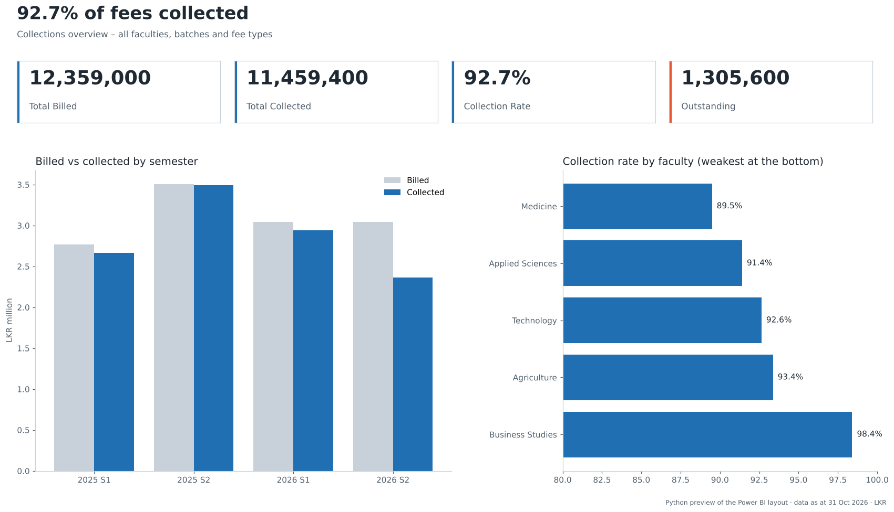
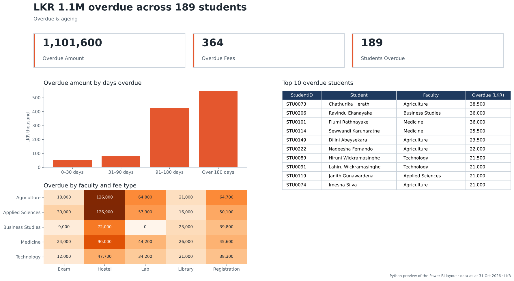
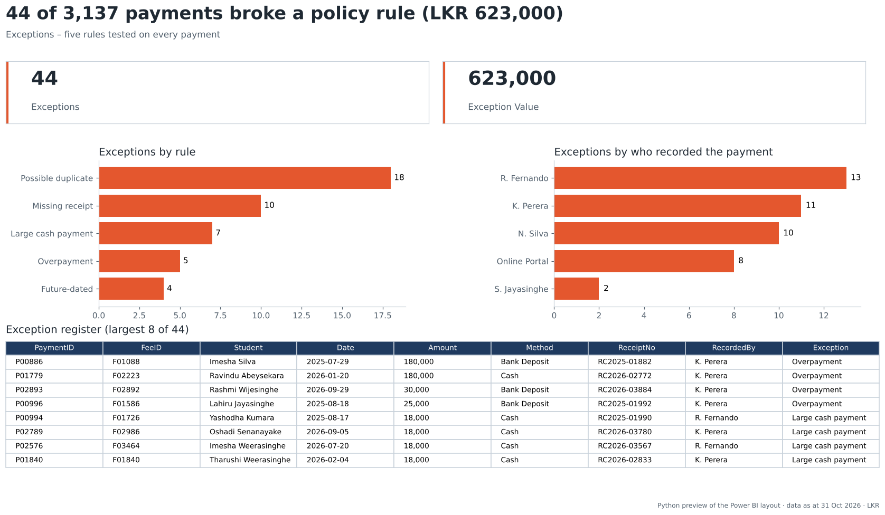

# Student Dues Monitoring – Power BI audit analytics

A three-page Power BI dashboard that monitors student fee collections and flags audit-style exceptions, with a Power Automate alert, a Copilot vs Claude output evaluation and a Copilot Studio policy agent. It is a small version of continuous controls monitoring: every payment is tested against five policy rules, and anything that breaks a rule lands in an exception register for review.

All data is **fictional**. Snapshot as at **31 Oct 2026**, amounts in **LKR**.



## The problem

Finance teams often track dues in spreadsheets and spot problems by hand. The goal here is continuous monitoring: collections, overdue risk and control breaches visible at a glance, with the cleaning and checks repeatable every month.

## What it shows

| Page | What it shows | Why it matters |
|---|---|---|
| 1. Collections overview | Billed, collected, outstanding, collection rate, trend by semester, weakest faculty | KPI monitoring |
| 2. Overdue & ageing | Overdue balances by faculty, fee type and days overdue; top 10 students | Risk / KRI monitoring |
| 3. Exceptions | Payments breaking any of the five policy rules, by rule and by who recorded them | Exception and anomaly detection |

## The five policy rules

Each payment is labelled with the **first** rule it breaks (see `powerbi/dax/calculated-columns.dax`).

1. **Possible duplicate** – the same fee paid more than once for the same amount
2. **Overpayment** – a single payment larger than the fee it pays
3. **Future-dated** – payment dated after the report date
4. **Missing receipt** – no receipt number
5. **Large cash payment** – cash over LKR 15,000 (needs prior Bursar approval)

## Key findings

- **92.7%** of LKR 12.36M billed has been collected; **LKR 1.31M** is outstanding.
- **LKR 1.1M is overdue across 189 students** (364 fees); LKR 545K of it is more than 180 days old.
- **44 of 3,137 payments (LKR 623,000)** broke a policy rule:

| Exception | Payments | Value (LKR) |
|---|---:|---:|
| Possible duplicate | 18 | 47,000 |
| Missing receipt | 10 | 17,000 |
| Large cash payment | 7 | 126,000 |
| Overpayment | 5 | 425,000 |
| Future-dated | 4 | 8,000 |

- The 18 duplicate rows are **9 pairs**; each one also makes its fee show as overpaid.
- The 5 overpayments look like an **extra zero typed** (e.g. 180,000 for an 18,000 hostel fee), all recorded by the same staff member.
- 8 payments actually break the large-cash rule; one is also an overpayment, so it is labelled Overpayment (first rule wins). A separate flag column per rule would show both.

## Check figures

Every measure on a Card with no filters should show:

| Measure | Expected |
|---|---:|
| Total Billed | 12,359,000 |
| Total Collected | 11,459,400 |
| Collection Rate | 92.7% |
| Outstanding | 1,305,600 |
| Overdue Amount | 1,101,600 |
| Overdue Fees | 364 |
| Students Overdue | 189 |
| Exceptions | 44 |
| Exception Value | 623,000 |

`python scripts/validate_numbers.py` re-implements the Power Query and DAX logic in pandas and checks these figures independently; it runs on every push via GitHub Actions.

## Repository layout

```
data/
  Student_Dues_Data.xlsx         About, Students (240), Fees (3,550), Payments (3,137)
  Exceptions.xlsx                exception register as Excel table "ExceptionRegister"
powerbi/
  README.md                      step-by-step build of the report
  Student_Dues_Monitoring.pbix   the report (added after building in Power BI Desktop)
  power-query/                   M scripts for the 3 tables + DataFile parameter
  dax/                           calculated columns and measures
  theme/                         report theme (blue = collected, orange = overdue/exception)
automation/power-automate-flow.md    weekly exception email flow
ai-evaluation/                   Copilot vs Claude test, scorecard and findings
copilot-studio/                  Fee Policy Assistant agent + 10 reusable test cases
docs/
  Fee_Payment_Policy.pdf         fictional policy (agent knowledge source)
  screenshots/                   Power BI, Power Automate and Copilot Studio screenshots
previews/                        static previews of the 3 pages, generated from the data
scripts/                         dataset generator, validator, workbook/PDF/preview builders
```

## Tools

Power BI Desktop (Power Query, DAX, data modelling) · Power Automate · Microsoft Copilot · Claude · Copilot Studio · Excel · Python (pandas) for the dataset and the independent check.

## Model

```
Students (1) ──< Fees (1) ──< Payments
  StudentID        FeeID
```

One student has many fees; one fee can have several payments. Both relationships are one-to-many with single cross-filter direction, so a Faculty slicer filters every visual.

## Reproduce

```bash
pip install -r requirements.txt
python scripts/generate_dataset.py     # rebuilds data/Student_Dues_Data.xlsx (deterministic)
python scripts/validate_numbers.py     # checks the expected figures
python scripts/make_workbooks.py       # Exceptions.xlsx + scorecard + agent test cases
python scripts/make_policy_pdf.py      # docs/Fee_Payment_Policy.pdf
python scripts/make_previews.py        # previews/*.png
```

Then build the report in Power BI Desktop following [`powerbi/README.md`](powerbi/README.md).

## Screenshots

| | |
|---|---|
| Overview |  |
| Overdue & ageing |  |
| Exceptions |  |

_The images above are generated previews. Power BI screenshots go in `docs/screenshots/` (`page1-overview.png`, `page2-overdue.png`, `page3-exceptions.png`, `flow-designer.png`, `flow-email.png`, `agent-test-chat.png`)._

## Next steps

- Read from a live source and replace the fixed report date with `TODAY()`.
- One flag column per rule, so a payment that breaks two rules shows both.
- Add an Approvals step to the flow that routes each exception to the person who recorded it.
- Have Copilot draft the weekly exception summary for an auditor to review.

## Licence

MIT – see [LICENSE](LICENSE). The dataset and policy are fictional and free to reuse.
